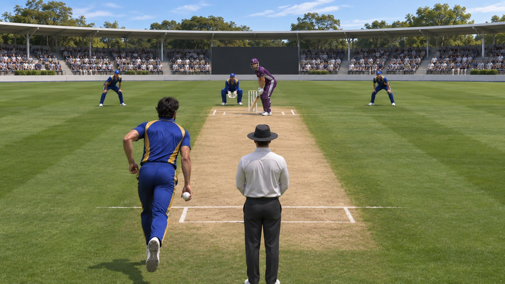
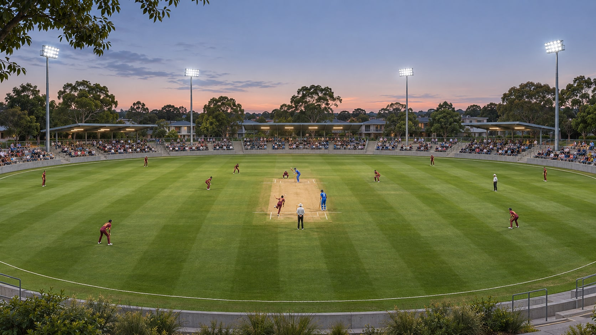
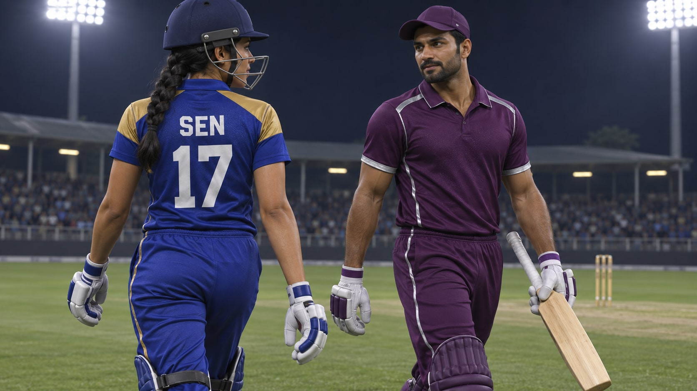

# Cricket 2027 art direction

**Delegated creative decision for #47 · 26 November 2026**

Use the visual language of a contemporary cricket broadcast at a fictional oval. Let the pitch, players and ball carry the image. Reserve strong colour for team kits and score or timing cues. Keep the sight screen quiet and stadium signage subdued. The frames below are original visual targets for later capture comparisons. The game’s pitch dimensions, field placements and camera geometry come from the sim and the camera specification.

## Day batting view

Use a neutral late-morning sun and a soft sky fill. Preserve the colour difference between the straw pitch and green outfield. The bowler’s silhouette, run-up, stumps and batter should all read down the pitch. Keep the elevated Auto camera from #90 and compare its release, bounce and contact frames at gameplay scale. The target frame concentrates on pitch and kit legibility.

## Dusk stadium wide

Use a peach horizon beneath a cool sky. Let neutral floodlights take over on the square so team colours remain consistent as the sky cools. The oval should feel attended, with visible concrete terraces, modest steel canopies and a seated crowd. Crowd silhouettes and clothing colours can read as a textured mass at this distance. Keep the pitch and circle markings clear of exaggerated glare or bloom.

## Night replay close-up

Hold neutral white light on the field against a blue-black background. Protect highlight detail on helmet shells, faces and shirt creases. Use separate head sculpts and body proportions for adult male and female athletes, with variation in height, build, skin tone and hair across the roster. Both silhouettes should wear the same team design language.

The reference pairing is cobalt with muted old-gold shoulder panels and aubergine with silver trim. Each existing team should keep its own identifiable primary colour. Use opaque, matte short-sleeve knit shirts and straight-leg trousers, with a fabric normal map visible in a replay and subdued from the broadcast camera. Keep the upper back clear for a high-contrast uppercase surname above a large number. Check the atlas on both body options as they turn, bend and raise their arms.

Use a satin helmet shell, slim steel grille, matte padded gloves and leg guards, and pale willow with visible face and edge grain. Compare front, rear and side views for intersections, especially the grille at the jaw, the pads at the knee and the gloves around the bat handle.

## Delegated browser review

- The `legacy-2027-match-setup` capture scenario checked both sides’ starting XIs in Male, Female and Mixed modes and verified that each selected mode started a two-over match. Its portrait sheet shows the three choices and the Play Match action inside the initial viewport.
- The `legacy-2027-bowler-end` sheet shows the default Auto camera over the run-up and delivery, then a wider follow view after play. The existing prototype is the framing baseline for the day target.
- The board is approved as the delegated art direction. Capture comparisons for the new players, production dusk and night, and the #34 screen flow remain open. The reviewed Chromium captures establish framing and setup behaviour for the current prototype. They provide no physical phone performance measurement.

The three concept images were created for this project with ImageGen. Prompt instructions and attribution are recorded in [2027 art reference sources](2027-art/README.md).
