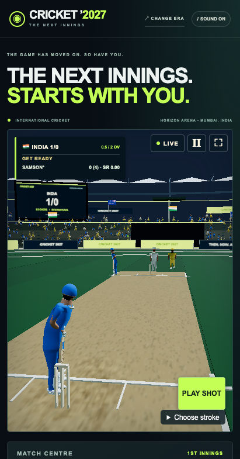

# Cricket 2027 task completion audit

Audited on 11 November 2026 on `codex/cricket-2027-realism`. This checklist covers the original numbered plan within the [documented simulation scope](modern-rules.md). It supersedes the pending statements in older dated progress entries.

The user approved Android/iOS emulation and scripted first-time play as substitutes for connected phones and a human tester. Those functional substitutes are complete. No further planned functional implementation or simulated acceptance scenario is pending. The user reaffirmed simulation-only validation after the later physical-device attempt described below. Hardware sign-off is deferred under that scope; the strict frame-time release criterion has not been certified.

| Task | Completion evidence | Status |
|---|---|---|
| 1. Measure one over | Six-ball classic, modern, touch and simulator measurements in the [baseline](delivery-baseline.md), including missed targets | Measurement complete; release sign-off deferred |
| 2. Fit one actor | Licensed local stock body, both-hand five-pose fit, planted feet and model-failure fallback | Complete |
| 3. Connect motion and ball | Hand release, timed preparation/contact/follow-through, missed stroke, keeper and return fixtures; replay records actual poses | Complete |
| 4. Assisted play | Primary batting/bowling controls and Enter, optional strokes/lengths, safe automatic singles and early cancel | Complete |
| 5. Frame the decision | Mirrored shoulder camera, yorker/spin bounce and receiving-end return captures and [game-speed review](qa/portrait-game-speed.mp4) | Complete using simulated phone review |
| 6. Match presentation | Physical pickup/return/wicket event order, boundary and extra scoring, umpire signals and event-driven sound | Complete |
| 7. Rules inventory and formats | Supported 2/5/10/20-over rules, scoring and free-hit fixtures, dead balls, field restrictions and T20 over-rate sanction | Complete within listed exceptions |
| 8. Wickets and close calls | Bowled, caught, LBW, stumped, run-out and hit-wicket out/safe conditions; rope, grounding and wide-stumping checks | Complete |
| 9. Bowling and surface response | Mirrored six-length [flight plot](qa/delivery-flight.svg), pace/spin variations, surface differences and 1.3 mm maximum sampled frame-rate delta | Complete |
| 10. Batting and running | Signed timing, reach, edge, handed shots, evasion/leg byes, declined singles, completed two and grounded-bat run-outs | Complete |
| 11. Field and opponent AI | Legal mirrored presets, optional field changes, keeper depth, pickup recovery, backups and completed AI chase | Complete |
| 12. Full cast and equipment | Shared fitted bodies with individual rigs/kits, both-hand grip checks, locomotion/grounding tests and distant-body fallback | Complete |
| 13. Ground, spectators and sound | Shared metre scale, circle alignment, wear/sightscreens, crowd reactions, contact sounds, captions and replay/pause event suppression | Complete |
| 14. Full match and first-time UX | Formats, innings break, chase, all-out, winning extra, final-ball wicket, tie/rematch, pause/resume and portrait/landscape scenarios | Complete using requested scripted-player substitute |
| 15. Delivery, performance and release | Local asset fallback, slow-network production smoke, batching, adaptive resolution, two-match resource and edition-navigation check | Functional and resource checks complete; release sign-off deferred |

## Final resource close-out

The two-match comparison retained 170 uploaded geometries, 58 textures, 26 shader programs and 530 DOM nodes at both results. One fitted-body request served both matches. JavaScript heap after garbage collection was 15.50 and 15.77 MB. Edition exit now explicitly releases renderer allocations and the WebGL context (`138eb9a`); history return opens a fresh game. The lifecycle browser scenario recorded zero uploaded geometries/textures after disposal and a working fresh renderer on return.

The 138-test full suite passed once. The two new lifecycle tests passed separately after that addition, and the final production build passed. The final built-output smoke completed a classic over with zero modern model requests, a cold modern scoring delivery with the fitted body, and a slow-network delivery with that model blocked. All three cases had zero JavaScript exceptions. Raw logs remain local in `/tmp/cricket-closeout`.

## Final Android simulation

The final cold Pixel API 36 / Chrome 134 over completed six legal deliveries at 411 × 785, ratio 0.8. Median frame interval was 16.8 ms and p95 was 83.4 ms using SwiftShader software rendering. All six accepted-shot responses met 100 ms (4.7–44.9 ms). This closes the requested emulator scenario, but it does not pass the frame target. The full [measurement record](delivery-baseline.md) preserves the miss. No game code changed during this verification pass.

## Deferred release criterion

Live frame p95 must be below 33 ms. Updated Safari simulator overs recorded 58 and 61 ms, with all six accepted-shot responses in each over below 100 ms. The mobile changes remove repeated cue mutations, backdrop blur, 54,000 seat triangles per ordinary frame and equipment batches from the shadow pass. These changes reduce work; the measurements do not establish a passing frame-time result.

A separate 8-second blank-page probe recorded 21 ms p95. Merely clearing a 321 × 392 WebGL canvas with the game's antialias/alpha settings recorded 36 ms p95, even without the cricket scene or simulation. The simulator therefore cannot certify this release target in the observed environment. These observations do not prove how a physical handset will perform.

A later availability check found a paired iPhone 12 Pro Max, but iOS rejected the Safari launch because the device was locked. No physical frame data was collected. The user then explicitly chose “Continue with simulation only.” Hardware sign-off is therefore deferred, and no further phone access is planned in this scope. Physical touch-to-display latency and human hesitation remain outside the evidence. The branch remains unpromoted; deferring this criterion does not mark it as passed.

Competition-specific tie-breaks, injuries/retirements, rain targets, licensed likenesses and cricket motion-capture are documented scope exclusions or future improvements, not additional tasks in this completion pass.

## Visual review

The reduced mobile scene retains the batting crease, release path, readable score and primary control.

